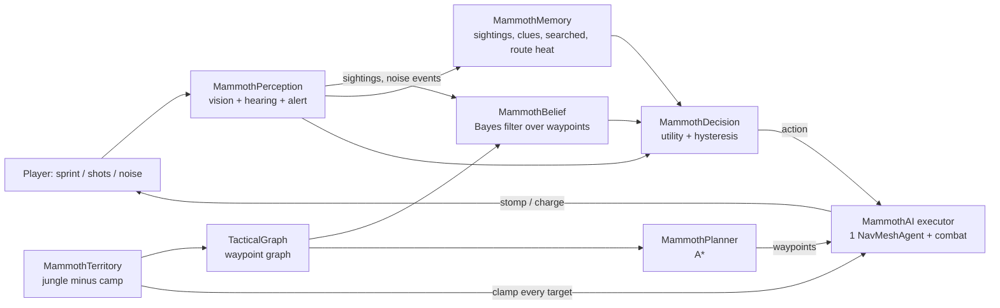

# Sanjula's Mammoth - autonomous agent (SE3062 Intelligent Systems, IT24103715)

The jungle boss "Sanjula's Mammoth" is a sense-think-act agent. The friend's Guard AI is untouched; everything is new files in
`Assets/_Project/Scripts/Runtime/Enhancements/` (namespace `LastShift`), built at run time from the scene's elephant by `MammothSpawner`.

## 1. Architecture

Per-frame data flow: **perceive -> update belief/memory -> (4 Hz) decide -> execute**. Only `MammothAI` moves the body; A* only chooses
waypoints, one `NavMeshAgent` walks them.

| File | Role |
|---|---|
| `MammothPerception` | Vision (range 42 m, 150 deg, line of sight, stealth multipliers) and noise hearing (gunshot 70 m, sprint 22 m, other 12 m, localisation error 15 % of distance). `IsAlert` = noise/hit in the last 25 s. |
| `TacticalGraph` | ~30 NavMesh waypoints (10 m grid, links <= 24 m where `!NavMesh.Raycast`), only inside the territory, flood-filled to what the mammoth can reach. |
| `MammothBelief` | Bayes filter: where is the player (probability per waypoint). |
| `MammothMemory` | Sighting ring buffer, noise clues (repeat clues ignored), searched-at penalty (40 s), route heat (half-life 90 s), hunt failures. |
| `MammothPlanner` | A* with binary heap; start-up self-check against Dijkstra. |
| `MammothDecision` | Utility engine choosing one of 7 actions. |
| `MammothAI` | Executes the action; stomp/charge combat; health/attack rules; boss bar HUD. |
| `MammothTerritory` | Jungle region minus camp exclusion circle: `Contains`, `Clamp`. |
| `MammothSpawner` | Clone/scale/recolour the elephant, retry spawn, connectivity-scored random home. |
| `MammothSelfTest`, `MammothDebugView` | F9/F8/F7 rule tests, F11 mind visualiser. |

## 2. Perception: noise-driven, never proximity-driven
* The mammoth hears **gunshots** (magazine count drops), **sprinting**, and other noises (`PlayerController.LastNoiseTime`: rustle, melee, interactions). Walking, crouching and standing are silent.
* Heard noise -> `NoiseEvent` with strength `1 - d/R` and a localisation error `sigma = max(2, 0.15 d)`.
* **Alert gate:** eyesight only confirms a target while `IsAlert` (heard something / was hit / enraged). A silent player in plain view is ignored, so it never hunts by proximity alone.
* Noise made inside the camp: only gunshots count (clamped to the camp edge); everyday camp noise is ignored.

## 3. Belief (Bayes filter)
State = waypoint. Each tick (0.2 s):
* **Predict:** diffusion to neighbours with rate `v*dt/spacing` (v = 3.2 m/s) plus a heading-momentum bias.
* **Sighting update:** likelihood `exp(-d^2 / 2 sigma^2)`, sigma = 6 m.
* **Noise update:** `eps + (1-eps) * Gaussian`, `eps = 0.05 + 0.4 (1 - strength)` (a weak noise is less informative).
* **Negative evidence:** waypoints the mammoth can see and where the player is not are down-weighted (rolling slice of 12 per tick).
* Floor mix 0.01, normalise (NaN guard), `confidence = 1 - H/Hmax`. State: Observed / Recent / Nearby / Uncertain / Lost.

## 4. Planning (A*)
`f = g + h`; `g` = edge length x (1 + slopeWeight x rise/length) (+ optional tactical cost); `h` = straight-line distance (admissible and consistent, so optimal).
Start-up check, e.g. `A* cost 78.8 ... vs Dijkstra 78.8 -> OPTIMAL (7 waypoints, 10 expanded)`. If the agent cannot reach a waypoint it is blocked for 25 s and the route is re-planned.

## 5. Decision (utility, 4 Hz, hysteresis)
| Action | Utility | Meaning |
|---|---|---|
| Patrol | 0.25 (floor) | wander the jungle patch around home |
| InvestigateSound | `0.6 * quality * exp(-age/15)` | go to a heard noise (quality = 1 - sigma/40) |
| TrackLastKnown | `0.55 fresh + 0.25 conf` (not arrived) | follow the last seen position |
| Search | `0.55 * recentEvidence * (1 - lost)` | pick waypoint with max expected information gain / distance |
| Pursue | gate: seen & alert & (inside aggro or provoked) -> `0.35 + 0.45 prox + 0.30 provoked + 0.25 enraged` | chase, stomp (< 6 m) or charge |
| Ambush | `0.5 * routeHeat * recentEvidence * min(1, failures/2)` | after failed hunts, wait silently at a hot route node |
| ReturnHome | `0.7 excursion + 0.5 lost*lostTime*farHome` | back to its patch |

Stability: current action x1.15 + 0.02, minimum commit times (Patrol 3 s, Investigate 2, Track 1.5, Search 3, Pursue 1, Ambush 3, Return 3), urgent override when the player is inside aggro range.
**Search information gain:** `gain(i) = beliefMass(within lookR of node i) * (1 - 0.85 searchPenalty)`, `lookR = lerp(10, 26, lost)`; chosen by `gain / (1 + dist/50)`.
**Enraged (< 35 % HP, i.e. from the 10th shot):** faster, shorter wind-up, leads the target by 0.6 s of player velocity, charges from up to 42 m and twice as often.

## 6. Territory
Jungle region (x -12..90, z -52..-2, widened to include the home) minus a 30 m circle around the player's start (the camp). `Clamp` pushes any target out of the circle (3 m margin) and, when the circle crosses the region border, falls back to the nearest legal point on the ring. Applied to graph nodes, every `NavMeshAgent` destination, wander points, charges (a charge ends at the border), noise clues, and a safety net walks it back if it ever strays. The decision engine never hunts a player standing in the camp.

## 7. Combat rules
* **Mammoth dies on exactly 15 valid shots.** Valid = damage >= 5, one per frame (shotgun pellets of one blast count once). After every hit its health is pinned to `max * (1 - shots/15)`; the 15th sets 0 -> `Health.Died` -> death behaviour (animation, roar, 3 ammo drops, colliders off, removed after 15 s). No healing, so the count is exact.
* **Player dies on exactly 20 mammoth attacks.** Each landed stomp/charge deals `max/20` (7.5 of 150). Not lethal before the 20th (`min(7.5, hp - 1)`), the 20th deals all remaining HP and calls `GameManager.Lose`.
* HUD (boss bar): `shots landed x/15, its attacks on you y/20`.

## 8. Controls / debugging
F10 reveals the hidden notice/aggro/leash rings; **F11** shows the mind panel + Scene-view graph, belief bars, A* route, camp circle; F9/F8/F7 run the self-tests (F8 kills the mammoth, F7 ends the run). A text log of `[MammothAI]` lines and a 5 s status line is written to `MammothTestLog.txt` next to the project.

## 9. Test results
See `Docs/MammothTestResults.md` (spawn x5, territory, silence, noise, 15 shots, 20 attacks - all PASS). Added later: 4 more sessions after the connectivity fix gave 23-33 reachable waypoints each. **Not verified in play:** the Ambush action and the enrage tactics (code paths compile and run but no scenario exercised them), real shotgun/slingshot/stick counting, sprint noise.

## 10. Known limitations
* Camp centre = player start position; the jungle box is hard-coded for `Level_01`.
* Clones the scene elephant, so it needs one in the level (the spawner retries and logs if missing).
* The F8/F7 tests inject damage through `Health.Damage` / `MammothAI.TestAttack`.
* Other enemies (e.g. the poacher) still damage the player; only mammoth attacks count towards the 20.

## 11. Viva notes
* **Why a Bayes filter, not "go to last position"?** It keeps a probability over where the player could be, so search is principled and it can combine weak evidence (a noisy, imprecise sound) with sightings and negative evidence.
* **Why A* and Dijkstra check?** A* with an admissible heuristic is optimal; the start-up comparison proves the implementation.
* **Why utility instead of a state machine?** Smooth trade-offs between competing goals; hysteresis and commit times stop flickering.
* **How does it not hunt a silent player?** Vision only confirms a target while alert; alertness comes only from noise/hits.
* **How is the 15/20 rule exact?** Health is pinned after each valid hit; attack damage is a fixed fraction with a non-lethal cap until the 20th.
* **What would you improve?** Per-weapon noise levels, learning the player's routes across sessions, data-driven territory authoring.
